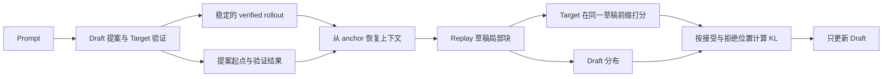
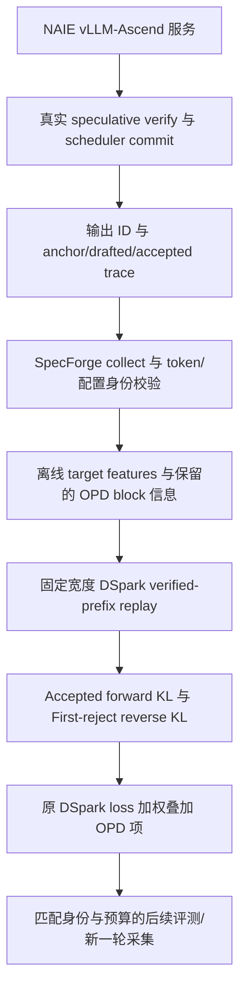

# 2026-11-12 Draft-OPD 论文原理详解

> 阅读范围：论文 arXiv v3 正文、附录 A–E，以及本文末尾列出的两个固定代码提交。本文区分论文实验结果、帮助理解的推导和本项目工程实现。两个仓库的 `mydocs/` 保存同一份原理文档；各自的适配细节另见同目录适配说明。

## 1. 先回答：Draft-OPD 在做什么

Draft-OPD 是对**推测解码草稿模型进行 on-policy 后训练**的方法。它希望草稿模型更懂得“大模型在当前上下文中会接受什么”，从而让每次昂贵的 target 验证接受更长的草稿，减少生成同样数量 token 所需的 target 调用。

方法的关键可以拆成三个动作：

1. 用正常的 speculative decoding 产生由 target 把关的高质量完整回答，同时记下草稿实际提案的起点。
2. 回到这些起点 replay 草稿，让 target 在**同一个草稿诱导的前缀**上提供监督，把推理时被丢掉的错误草稿重新变成训练数据。
3. 接受位置用 forward KL 保持对 target 分布的覆盖；拒绝位置用 reverse KL 压低草稿自身偏好的错误模式，并降低较晚错误后缀的权重。

最终更新的是 draft；target 冻结，推理仍使用原有的严格验证过程。论文追求的是**提高生成效率**，不声称提高 target 的知识或回答质量。损失降低也不自动意味着某个具体部署的吞吐一定提高，需要在实际推理引擎中测量。

来源：[论文摘要、§3–4](https://arxiv.org/html/2605.29343v3#S4)、[局限性](https://arxiv.org/html/2605.29343v3#Sx1)。

## 2. 论文身份、版本和阅读口径

| 项目 | 核对结果 |
| --- | --- |
| 论文 | *Draft-OPD: On-Policy Distillation for Speculative Draft Models* |
| 作者 | Haodi Lei 等 |
| arXiv 首次提交 | 2026-05-28 |
| arXiv 第二版 | 2026-05-29 |
| arXiv 第三版 | 2026-09-18 |
| 正式发表 | EMNLP 2026 主会，2026 年 10 月，页码 26128–26141 |
| 本文整理日期 | 2026-11-12；距首版约五个半月，正式发表在上个月 |
| 方法与表格依据 | arXiv v3 可检索正文及附录；正式发表信息依据 ACL Anthology |

用户引述中的“截至今天 11 月 10 日”是原描述的时间点；本文采用整理当天 11 月 12 日。这里没有将 arXiv 首次公开等同于会议正式发表。

来源：[arXiv 版本记录](https://arxiv.org/abs/2605.29343)、[ACL Anthology 正式论文条目](https://aclanthology.org/2026.emnlp-main.1139/)。

## 3. 理解方法前需要明确的几个对象

### 3.1 Target、draft 与 verifier

- **Target** $p_\theta$：真正希望保持其输出分布的大模型；训练中作为冻结教师。
- **Draft** $q_\phi$：较轻的草稿模块；负责一次提出多个候选 token；训练更新参数 $\phi$。
- **Verifier**：用 target 对候选块进行并行检查，接受最长的合法前缀，然后纠错或补充后续 token。
- **Verified rollout**：经过验证、最终提交的回答 token 序列。
- **Draft block**：某轮草稿实际提出的候选块；它可以包含最终没有进入回答的 token。
- **Anchor**：一轮草稿所依赖的 verified prefix 的边界；用于之后重建该轮局部预测问题。

论文主要研究的是为特定 target 训练出来的 EAGLE/DFlash 一类模块。这类模块往往依赖 target hidden states，常与 target 共享 embedding 或 LM head，主要擅长短块提案，不能直接当成一个质量稳定的独立小语言模型运行。

因此，“小模型能自己生成完整回答”不能作为这里的默认前提。论文实做的 OPD 后训练基于 DFlash 风格并行草稿；它把 EAGLE-3 作为对照，不等于已经逐个验证了所有草稿架构的 OPD 训练。

来源：[§2–3](https://arxiv.org/html/2605.29343v3#S3)、[§4.1](https://arxiv.org/html/2605.29343v3#S4.SS1)。

### 3.2 接受长度为什么影响速度

设一轮有 $K$ 个候选，连续接受的草稿数为 $r\in[0,K]$。只有前面的候选都通过，后面的候选才有机会被使用。早期失败会截断后面整个草稿块的收益。

以下是帮助理解的推导，而非论文新增定理：若定义事件 $A_j$ 为“前 $j$ 个候选全部接受”，则整数随机变量的尾和公式给出

$$
\mathbb E[r]=\sum_{j=1}^{K}\Pr(A_j).
$$

这解释了为什么一个早期错误会影响多个后续项，而不只是一个 token 的准确率。但真实 wall-clock speedup 还包含 draft 计算、target 验证、调度、KV cache、通信和并发成本，不能直接把 $\mathbb E[r]$ 当作速度倍数。

论文将 $\tau$ 描述为每次验证接受的草稿长度。工程系统则可能统计“接受草稿 + 一个 target 纠正/bonus token”。读取 trace 和比较指标时必须先统一口径。尤其不能把 vLLM 内部 `accepted` 字段不加转换地代入论文公式。

### 3.3 无损的含义

在正确的严格 speculative verification 下，改变 draft 只改变提案质量与验证开销，目标仍是保持 target 的输出分布。这里的“无损”不是“所有随机采样运行都逐 token 得到同一个样本”，也不是“任何修改过的 verifier 都自动正确”。它依赖原有验证算法以及采样配置的正确实现。

论文因此主要报告接受长度、相对 vanilla autoregressive decoding 的速度和 serving throughput，而没有把提高生成质量作为训练收益。

来源：[§3、§5 Metrics](https://arxiv.org/html/2605.29343v3#S5)。

## 4. 为什么继续 SFT 容易到平台期

### 4.1 SFT 的状态来自谁

传统做法先让 target 生成训练回答，再在这些固定轨迹上训练 draft。即使损失使用教师分布，这些训练状态仍来自 target 的正确前缀。

推理时，草稿块的后续位置可能依赖草稿自己先前提出的 token。只要前面发生偏差，后面遇到的局部状态就可能不在离线教师轨迹中。训练学习的是“在老师走过的路上怎样预测”，推理要解决的是“在自己的短块提案里怎样避免走偏”。

论文图 1 观察到：SFT 初期提升明显，继续训练之后，测试集接受长度较快进入平台；切换到 OPD 后可以进一步提升。这是论文在其模型和训练设置下的观测，并非所有 SFT 训练必然停滞的普遍定理。

### 4.2 普通 on-policy distillation 的想法

普通 OPD 让 student 先按自己的策略生成：

$$
\tilde y\sim q_\phi(\cdot\mid x),\qquad s_t=(x,\tilde y_{<t}).
$$

教师随后在同一个状态 $s_t$ 给出下一 token 分布。论文 §3 的标准形式是

$$
\mathcal L_{\mathrm{OPD}}
=\mathbb E_{s_t}\left[D_{\mathrm{KL}}\big(p_\theta(\cdot\mid s_t)\,\|\,q_\phi(\cdot\mid s_t)\big)\right].
$$

“On-policy”的核心是**训练状态的来源**，不是“数据刚刚生成”“用了 KL”或“模型一边服务一边训练”。如果永远只在 teacher 正确轨迹上计算 KL，新鲜数据也仍可能没有覆盖草稿自己引出的错误状态。

来源：[§1 图 1](https://arxiv.org/html/2605.29343v3#S1)、[§3 式 2–3](https://arxiv.org/html/2605.29343v3#S3)。

## 5. 为什么两个直接方案都不够

### 5.1 让草稿独立生成完整回答

EAGLE/DFlash 风格模块为依赖 target 特征的短跨度预测设计。强行让它们脱离 target、独立长距离 rollout，论文展示了重复和退化的样本。形式上由 student 自己走出来的序列，也可能没有足够稳定的学习价值。

### 5.2 只保留 target-assisted 的最终回答

正常推测解码可以避免回答退化，但 verifier 会丢弃第一个拒绝点及其后缀。因此，若只保存最终回答，再对它做蒸馏，保存下来的仍然是 target 分布上的轨迹，最有价值的草稿错误恰好被过滤掉了。

这不意味着 accepted tokens 没有价值，而是只保留 accepted/纠正后的最终序列，无法完整表达“草稿曾经犯了什么错”。论文 §5.3 把这种朴素方案视为在 target-distributed trajectories 上做 KL-loss SFT。

### 5.3 Draft-OPD 的处理

完整回答继续由 target 把关；训练则回到草稿提案发生的位置，重建局部草稿行为。在长轨迹质量与局部草稿错误信号之间建立接口。

来源：[§4.1–4.2、图 2–3](https://arxiv.org/html/2605.29343v3#S4)。

## 6. 完整 Draft-OPD 的采集与 replay

### 6.1 论文的符号

| 符号 | 含义 |
| --- | --- |
| $x$ | Prompt |
| $y=(y_0,\ldots,y_{T-1})$ | 经过验证的 rollout |
| $a_m$ | 第 $m$ 轮之前 verified prefix 的末位置；开头可写为 $-1$ |
| $c_m=(x,y_{\le a_m})$ | 第 $m$ 轮 replay 上下文 |
| $d_m=(d_{m,1},\ldots,d_{m,K})$ | 草稿块 |
| $r_m$ | 接受的草稿前缀长度 |
| $p_{m,k},q_{m,k}$ | 在相应 replay 状态下 target/draft 的下一 token 分布 |

论文以自回归条件概率形式抽象描述草稿块。具体到 DFlash/DSpark 这类并行草稿，实际 query、mask、target feature 和 anchor token 的布局必须以各自实现为准，不能仅凭公式假定它们有独立 AR 模型的输入方式。

### 6.2 Rollout 阶段

在 $c_m$ 上提出草稿块：

$$
d_m\sim q_\phi(\cdot\mid x,y_{\le a_m}).
$$

记录 anchor，执行验证，然后继续提交 target 认可的续写。完整 rollout 直到 EOS 或长度上限。论文强调，同一 rollout 已经算出的 target hidden states 可以为后续 replay 重用。

**索引落地提醒：**§4.2 用 $a_m+r_m$ 描述下一 anchor 的移动，但该抽象没有展开所有服务引擎中的纠正/bonus token 约定。工程里应先定义 anchor 是 token 下标还是 prefix 长度、输出增量是否含 target token，再确定递推。不能据此让零接受的一轮不推进，也不能把 target 补充 token 算成一个被接受的草稿。

### 6.3 Replay 阶段

对每个 anchor 重建上下文，在草稿前缀下计算

$$
\log q_{m,k}(d_{m,k})
=\log q_\phi(d_{m,k}\mid c_m,d_{m,<k}),
$$

$$
\log p_{m,k}(d_{m,k})
=\log p_\theta(d_{m,k}\mid c_m,d_{m,<k}).
$$

教师与学生必须在**同一个状态**上打分。如果学生看的是错误草稿前缀，教师却看的是最终纠正后的 rollout 前缀，得到的是两个不同条件分布，不能当作论文定义的局部 KL。

论文中的 rejected 集合包含**首个失败 token 和同块后面所有失效位置**。后面的候选未必各自都被独立判为错误；它们首先是因为前面已经失败而不能提交。

### 6.4 一个例子

假设 verified prefix 是 $C$，草稿提出 `[A, B, X, Z]`，target 接受 `[A, B]`，在第三个候选处拒绝并给出纠正 token `Y`。

- 服务最终回答进入 `C A B Y …`，不会把 `X Z` 发给用户。
- 完整 Draft-OPD 训练 `A` 时看 $C$，训练 `B` 时看 $C,A$。
- 训练首拒 `X` 对应位置时，teacher/student 都看 $C,A,B$。
- 若继续训练 `Z` 对应位置，两者都必须看 $C,A,B,X$，不能换成 $C,A,B,Y$。

首拒之前的条件前缀与 verified rollout 一致；首拒之后的条件前缀已经分叉。这是我们后面选择 first-reject-only 工程路径的关键。

来源：[§4.2 式 4–9](https://arxiv.org/html/2605.29343v3#S4.SS2)。

## 7. Acceptance-aware KL：公式和直觉

### 7.1 两个集合

$$
\mathcal I_{\mathrm{acc}}=\{(m,k):1\le k\le r_m\},
\qquad
\mathcal I_{\mathrm{rej}}=\{(m,k):r_m<k\le K\}.
$$

“接受/拒绝”首先是该次 rollout/replay 对应的验证标签。采集使用的 draft 权重、配置、词表、采样方式会决定这些标签，训练数据应保留相应身份，不能在恢复训练时随意换一个 collecting draft 仍声称数据完全 on-policy。

### 7.2 Accepted 用 forward KL

$$
\mathcal L_{\mathrm{acc}}
=\frac{1}{|\mathcal I_{\mathrm{acc}}|}
\sum_{(m,k)\in\mathcal I_{\mathrm{acc}}}
D_{\mathrm{KL}}(p_{m,k}\,\|\,q_{m,k}).
$$

对固定状态展开：

$$
D_{\mathrm{KL}}(p\|q)
=\sum_{v\in\mathcal V}p(v)\big(\log p(v)-\log q(v)\big).
$$

教师冻结时，最小化它等价于最小化教师分布加权的交叉熵。target 认为有概率的候选，draft 不应漏掉。论文将 accepted 状态视为可靠的监督位置，希望继续匹配完整 target 分布。

### 7.3 Rejected 用 reverse KL

$$
\mathcal L_{\mathrm{rej}}
=\frac{1}{Z}
\sum_{(m,k)\in\mathcal I_{\mathrm{rej}}}
 w_kD_{\mathrm{KL}}(q_{m,k}\,\|\,p_{m,k}),
\qquad
Z=\sum_{(m,k)\in\mathcal I_{\mathrm{rej}}}w_k.
$$

其中

$$
D_{\mathrm{KL}}(q\|p)
=\sum_{v\in\mathcal V}q(v)\big(\log q(v)-\log p(v)\big).
$$

这个方向由 draft 概率加权，对“draft 给很高概率、target 却不支持”的模式施加更直接的惩罚。它不是简单把某个错误 token 的概率设成零，也不是只学 target 的 argmax。

附录 B 的论证是**局部目标设计的解释**：在固定 replay 状态、草稿分布不受容量约束时，两种 KL 的最优点都是 $q=p$。论文没有证明混合 KL 对所有任务、优化器与模型都必然更好；表 3 提供的是在其设置下的消融支持。

### 7.4 只对 rejected suffix 做位置衰减

$$
w_k=\gamma^{k-1},\qquad \gamma=0.8\ \text{（默认）}.
$$

越靠后的 rejected suffix 越受早先错误影响，且早期错误对接受长度更直接，因此降低后部权重。

这里的 $k$ 是**草稿块内的绝对位置**，不是“距离第一次拒绝还有多远”。例如某块接受 2 个，首拒在第 3 个位置，则该首拒项原始权重为 $\gamma^2$。论文再用全部 rejected 权重之和 $Z$ 归一化；不能把实现中的逐块归一化与论文的集合归一化混为一谈。

论文此处的 “Weight Decay” 指 token 位置权重衰减，**不是 AdamW 优化器的参数 weight decay**。

### 7.5 最终目标

$$
\mathcal L_{\mathrm{Draft\text{-}OPD}}
=\frac{\lambda_{\mathrm{acc}}\mathcal L_{\mathrm{acc}}
+\lambda_{\mathrm{rej}}\mathcal L_{\mathrm{rej}}}
{\lambda_{\mathrm{acc}}+\lambda_{\mathrm{rej}}},
\qquad
\lambda_{\mathrm{acc}}=\lambda_{\mathrm{rej}}=1.
$$

先分别归一化，再按组组合，意味着它不是简单把全部 token 的 KL 求一个平均。accepted 和 rejected 数量不相等时，两种写法的梯度权重会明显不同。若某批没有某一类位置，工程中还必须显式处理空集合，避免除零；这是实现必须补齐的边界条件。

### 7.6 一个 token 的 log-prob 不等于完整 KL

式 6–7 写出了实际候选 token 的 log-prob；式 10–11 的 KL 则是相应状态上**整个词表分布**之间的散度。仅有一个 token 的两个 log-prob，不能直接精确恢复 full-vocabulary KL。若采用采样估计，需要额外说明估计器与梯度处理方式。

我们的 SpecForge 实现会在 replay 位置重新算 teacher/draft logits，然后计算分布 KL；不能仅从 trace 中的 `accepted` 数字推导 KL 值。使用 draft vocab 子集时，还要说明投影与归一化口径，详见适配文档。

来源：[§4.2 式 10–13](https://arxiv.org/html/2605.29343v3#S4.SS2)、[附录 B](https://arxiv.org/html/2605.29343v3#A2)。

## 8. 论文为什么专门讨论“只训练首拒位置”

### 8.1 First-rejected-only 变体保留了什么

论文 §6.1 的变体保持 accepted forward-KL 目标不变；每个失败块的 rejected reverse-KL 只保留第一个拒绝位置。并不是“只学首拒，所有 accepted 位置都不要”。

这有一个很有用的工程性质：首拒之前草稿前缀仍与 verified prefix 相同，因此可以重用 verified 轨迹及其 target features。若只需要到首拒为止的分布，通常不必再对错误后缀构建完整的 target replay 分支。

### 8.2 表 5 的证据

| Benchmark | First-rejected-only 的 $\tau$ | 完整 Draft-OPD 的 $\tau$ |
| --- | ---: | ---: |
| GSM8K | 6.32 | 6.39 |
| AIME25 | 6.36 | 6.32 |
| MATH-500 | 6.57 | 6.57 |
| MBPP | 5.81 | 5.73 |
| HumanEval | 6.14 | 6.12 |
| MT-Bench | 4.32 | 4.44 |
| SWE-Lite | 6.08 | 6.07 |
| 平均 | 5.94 | 5.95 |

两者平均几乎相同，且单项互有高低。论文据此认为首拒包含大部分有用错误信号，并指出 truncated replay 有望节省 replay 计算。

**证据边界：**这是该消融设置下的结果，不是跨架构等价定理；表 5 没有给出我们 DSpark/Ascend 实现的训练成本或性能，也不能据此声称我们已复现 5.94/5.95。

### 8.3 对本项目的意义

我们选择以 verified-prefix replay + first-reject KL 作为 DSpark 的适配方向，具有论文中明确讨论的依据。但收集字段、query 宽度、词表映射、附加到原 DSpark loss 的方式，都属于自己的工程实现，不能直接写成“完整照搬论文全部训练系统”。

来源：[§6.1、表 5](https://arxiv.org/html/2605.29343v3#S6.SS1)。

## 9. 论文如何训练，成本是多少

### 9.1 模型和初始化

- Target：Qwen3-4B、Qwen3-8B、Qwen3-30B-A3B-Thinking-2507。
- Draft：DFlash 风格；4B/8B 使用 5 个 Transformer 层，30B-A3B 使用 8 层。
- 训练、推理 block size 均为 16。
- Draft-OPD 从 6 个 SFT epochs 后的 checkpoint 开始后训练。
- EAGLE-3/DFlash 对照在相同数据设置下 SFT 训练到 10 epochs，选最佳评测 checkpoint；论文按近似总训练 FLOPs 对齐，而非只按 epoch 数对齐。

### 9.2 OPD prompt 池

共 16K prompts，仅取问题/指令；回答由在线 target-assisted rollout 生成：

| 来源 | 数量 | 备注 |
| --- | ---: | --- |
| GSM8K train | 2K | 训练问题 |
| MATH | 5K | 排除 MATH-500 held-out 样本 |
| AoPS | 4K | 数学问题 |
| CodeAlpaca | 5K | 代码指令 |

附录说明该池与 SFT 数据分开。数据消融还让基线使用同一 OPD prompt 池生成的 target responses 继续 SFT，以排查收益是否仅来自增加训练问题。

### 9.3 训练参数与硬件

| 项目 | 论文设置 |
| --- | --- |
| 优化器 | AdamW |
| 学习率 | $3\times10^{-4}$ |
| 调度 | cosine，warmup ratio 0.05 |
| OPD epochs | 8 |
| 全局训练 batch size | 24，见附录表 7 |
| OPD steps | 约 5.3K，Qwen3-4B 配置 |
| 最大训练回复 | thinking 4096；non-thinking 2048 |
| SFT 框架 | SpecForge |
| OPD 框架 | verl |
| GPU | 4B/8B 用 8 张 H200；30B-A3B 用 16 张 H200 |
| 4B OPD 耗时 | 约 15 小时，8 张 H200，约 120 H200 GPU-hours |

论文 §5 中“batch size 1”对应主要推理评测设置，不能据此把 OPD 的 global training batch size 写成 1。120 GPU-hours 的口径包含冻结 target 的 rollout/verification 计算；它不是 Ascend NPU-hours，也不能按设备数直接换算。

论文使用 SpecForge 做 SFT、verl 做 OPD。我们在 SpecForge 内增加首拒蒸馏训练路径，是自己的整合方式；没有证据说明本分支已经把论文原始 verl 系统原样迁移到 Ascend。

来源：[§5 实验设置](https://arxiv.org/html/2605.29343v3#S5)、[附录 A、表 7](https://arxiv.org/html/2605.29343v3#A1)。

## 10. 主要实验结果应当怎样读

### 10.1 任务与评测设置

数学：GSM8K、MATH-500、AIME25；代码与软件工程：MBPP、HumanEval、SWE-bench Lite；对话分布外评测：MT-Bench。

主表分别评估 thinking/non-thinking 和 temperature 0/0.6。采样评测采用 temperature 0.6、top-p 0.95、top-k 20；thinking 最大生成 8192 tokens，non-thinking 2048。EAGLE-3 对照使用 tree size 16、draft steps 8、top-k 4。不同草稿结构有不同计算开销，因此接受长度最高的方法未必速度最快。

### 10.2 表 1 的跨任务平均值

下表每行是对应 target 在七个 benchmark 上的平均，speedup 的基准是普通 AR decoding：

| 模式 | Target | EAGLE-3 speedup / $\tau$ | DFlash speedup / $\tau$ | Draft-OPD speedup / $\tau$ |
| --- | --- | --- | --- | --- |
| Thinking，T=0 | Qwen3-4B | 3.87× / 5.33 | 4.33× / 5.51 | 4.86× / 5.96 |
| Thinking，T=0 | Qwen3-8B | 4.06× / 5.64 | 4.34× / 5.19 | 4.89× / 5.73 |
| Thinking，T=0.6 | Qwen3-4B | 3.40× / 5.03 | 3.84× / 4.77 | 4.15× / 5.13 |
| Thinking，T=0.6 | Qwen3-8B | 3.62× / 5.33 | 3.82× / 4.66 | 4.19× / 5.05 |
| Non-thinking，T=0 | Qwen3-4B | 4.30× / 5.84 | 4.84× / 6.04 | 5.31× / 6.60 |
| Non-thinking，T=0 | Qwen3-8B | 4.63× / 5.99 | 5.11× / 6.04 | 5.60× / 6.57 |
| Non-thinking，T=0.6 | Qwen3-4B | 3.78× / 5.66 | 4.48× / 5.73 | 4.81× / 6.13 |
| Non-thinking，T=0.6 | Qwen3-8B | 4.06× / 5.69 | 4.57× / 5.62 | 4.95× / 6.02 |

在 thinking、T=0 设置下，两模型平均 speedup 约 4.88×，相对 EAGLE-3 和 DFlash 分别约提高 23% 和 13%。论文摘要中的“over 5×”对应若干具体任务结果，**不表示所有 thinking 任务或 thinking 跨任务平均都超过 5×**。例如表 1 的 thinking Qwen3-4B 在 MATH-500 上达到 5.55×，但 MT-Bench 为 3.18×。

也有需要保留的细节：thinking、Qwen3-8B、T=0.6 时，EAGLE-3 的平均 $\tau=5.33$ 高于 Draft-OPD 的 5.05；但 Draft-OPD speedup 4.19× 高于 EAGLE-3 的 3.62×。这说明并行草稿成本同样重要。

### 10.3 SGLang serving 结果

论文还用 SGLang + FA3 backend，在并发 1、4、8、16、32 下测试 AIME25、MATH-500、SWE-Lite，包括 4B、8B、30B-A3B targets。论文报告各 model-task 对的平均接受长度相对 DFlash 提升 11.2%，吞吐最高相对提高 17%。

例如 Qwen3-30B-A3B-Thinking 在 AIME25、并发 32 时，DFlash 4014 tok/s，Draft-OPD 4718 tok/s，约提高 17.5%，表格标为 17%。这是对 DFlash 的吞吐增益，不是相对 AR 的 17× 加速。

这些是 NVIDIA H200 / SGLang 的论文结果。本项目的 vLLM-Ascend、Qwen3.8、DSpark、NPU、量化和固定 7 候选设置，均需单独验证。

来源：[§5.1、表 1–2](https://arxiv.org/html/2605.29343v3#S5.SS1)。

## 11. 消融实验回答了哪些问题

### 11.1 是 OPD 还是仅仅更多数据

论文让 EAGLE-3/DFlash 用 OPD prompt 池生成的 target responses 继续监督训练，仍落后于 Draft-OPD。它支持“草稿诱导状态上的监督具有额外价值”的解释，不应把收益完全归为新 prompt 数量。

### 11.2 混合 KL、anchor、衰减分别有用吗

表 3 的 Qwen3-4B 结果：

| 方法 | MATH-500 speedup / $\tau$ | HumanEval speedup / $\tau$ | MT-Bench speedup / $\tau$ |
| --- | --- | --- | --- |
| Draft-OPD | 5.55× / 6.57 | 5.17× / 6.18 | 3.18× / 4.44 |
| 无 rejected 位置衰减 | 5.13× / 6.18 | 4.96× / 6.01 | 3.07× / 4.29 |
| 全部 reverse KL | 5.11× / 6.14 | 4.94× / 5.98 | 3.08× / 4.33 |
| 全部 forward KL | 5.34× / 6.35 | 5.01× / 6.09 | 3.09× / 4.33 |
| 随机 anchors | 5.04× / 6.08 | 4.99× / 6.07 | 2.96× / 4.24 |

论文 §4.2 按实际提案起点记录 anchors；消融又以“error-position replay”与随机 anchors 作比较。稳妥理解是**围绕真实 draft/verify 交互暴露的局部错误状态训练**，而不是把 anchor 字段直接解释为首拒 token 的绝对坐标。服务端 block 起点与首拒位置仍需通过 accepted count 计算联系。

### 11.3 仅 target-assisted rollout 够吗

表 4 中，naive rollout 的 MATH-500/HumanEval/MT-Bench speedup 分别为 5.06×、4.80×、3.02×，均低于 Draft-OPD。三任务平均从约 4.63×降到 4.29×，论文描述为相对下降 7.3%。稳定 rollout 解决了样本质量，但单独使用它仍丢失草稿错误。

### 11.4 为什么不对 accepted 位置也衰减

表 6 中，给 accepted token 同样加 $\gamma=0.8$ 衰减后，七任务平均 $\tau$ 从 5.95 降到 5.86。论文解释为：accepted prefix 仍是可靠轨迹，较后 accepted token 不应仅因位置靠后就被削弱。

### 11.5 参数敏感性与训练过程

- 附录 C：$\gamma\in\{0.95,0.80,0.65,0.50\}$ 时，四任务平均 $\tau$ 在 6.24–6.26，所测范围较稳定。
- 固定 $\lambda_{\mathrm{acc}}=1$，$\lambda_{\mathrm{rej}}$ 从 0.5 到 2.0 扫描；0.8 的平均 6.27 最高，默认 1.0 为 6.25，2.0 为 6.20。过分强调 rejected 位置不一定更好。
- 附录 D：训练前后半段，第 1–3 位置首拒的占比从 39.61% 降至 38.23%；full accept 从 5.68% 升至 6.02%。这是接受行为向更晚失败移动的观测。

附录 D 的表 10 列出首拒位置 1–15 和 full accept，而正文把块大小描述为 16。本文保留其原表分组，不自行补造“第 16 位置首拒”数据；跨实现时应核查 block 是否包含 anchor/bonus 等槽位。

来源：[§5.2–5.3](https://arxiv.org/html/2605.29343v3#S5.SS2)、[§6.2](https://arxiv.org/html/2605.29343v3#S6.SS2)、[附录 C–D](https://arxiv.org/html/2605.29343v3#A3)。

## 12. 论文的边界与复现时容易误读的地方

### 12.1 长轨迹覆盖不足

Thinking 训练回复上限是 4096，评测上限是 8192。论文承认训练未充分覆盖长回答的后半段状态。不能把长评测上仍有增益解释为已经解决所有超长推理轨迹问题。

### 12.2 结构、模型与硬件泛化仍需验证

主要目标模型是 Qwen3，OPD 实现在 DFlash 风格并行 draft 上。EAGLE-3 是比较对象；部署验证在 SGLang。迁移到 Qwen3.8、DeepSeek、DSpark、Ascend、其他调度器或量化配置，需要核对输入、features、词表和验证语义。

### 12.3 Thinking 模式为什么更难 draft

附录 E 在 ShareGPT、AoPS 和 Nemotron 数学/代码数据上比较 target 的逐 token NLL，thinking 模式更高。论文认为更分散的下一 token 分布增加了草稿匹配难度。这是实验支持的解释，不应简化为“所有 thinking token 都更随机”或“OPD 消除了推理不确定性”。

### 12.4 On-policy 是一个需要维护的条件

从当前草稿采集数据，再对这个数据集训练多个 step/epochs 后，数据相对新权重逐渐陈旧。工程应记录 collecting draft 身份、配置和数据 provenance，并通过新的采集轮次刷新。保存一个带 `opd` 名字的数据文件，不会永久保证 on-policy。

### 12.5 不应混为一谈的量

| 容易混淆 | 应区分 |
| --- | --- |
| 草稿错误 token 与最终输出 token | 前者可能被 verifier 丢弃 |
| 首拒位置与 block anchor | 一个是局部失败位置，一个是 replay 上下文边界 |
| 草稿接受数与本轮提交数 | 提交可能额外含 target 纠正/bonus token |
| 论文 block size 16 与本项目 7 proposals | 可能还分别存在 anchor/query 槽位 |
| 完整 KL 与候选 token log-prob 比 | 前者需要分布或明确的采样估计 |
| 位置 Weight Decay 与 AdamW weight decay | 两者作用对象不同 |
| 接受长度与实际 speedup | 后者受硬件和算法开销影响 |
| 首拒消融的论文结果与本项目验证 | 实验环境和实现均不同 |
| collecting draft 与更新后的 draft | 旧数据是前者诱导的状态 |

来源：[论文 Limitations](https://arxiv.org/html/2605.29343v3#Sx1)、[附录 E](https://arxiv.org/html/2605.29343v3#A5)。

## 13. 我们做了什么：两个仓库的职责

### 13.1 固定代码范围

| 仓库 | 分支 | 本文核对版本 | 职责 |
| --- | --- | --- | --- |
| vLLM-Ascend | `030_dspark_opd_trace` | `ce9ca72d1` | 在 NAIE 推理基线上暴露可用于 replay 的真实调度提交轨迹 |
| SpecForge | `codex/qwen38-dspark-first-reject-opd` | `a99ab23d` | 采集、校验、转换 trace，重建 verified-prefix draft 分布，加入首拒蒸馏并支持对比评测 |

对应代码：[vLLM-Ascend 固定提交](https://github.com/fg11991/vllm-ascend/tree/ce9ca72d1)、[SpecForge 固定提交](https://github.com/fg11991/specforge/tree/a99ab23d)。

### 13.2 端到端数据流

vLLM-Ascend 侧提供事实记录，SpecForge 侧完成训练。打开服务 trace 开关本身不会更新草稿；单独让训练端读最终输出也不会自动恢复错误后缀。

### 13.3 我们与完整论文方法的对应关系

| 项目 | 论文完整 Draft-OPD | 本项目当前方向 |
| --- | --- | --- |
| 稳定轨迹 | Target-assisted speculative rollout | 保留服务实际提交的 verified token IDs |
| 局部状态 | 从实际 anchors replay | 用 scheduler trace 与离线 features 恢复 verified-prefix 状态 |
| 错误监督范围 | 首拒及后面 rejected suffix | accepted 位置 + 每个失败块的 first reject |
| Accepted objective | Forward KL | Forward KL |
| Rejected objective | Reverse KL，位置衰减 | First-reject reverse KL；不实现完整错误后缀衰减 |
| 后缀错误 token | 完整 replay 必须能恢复其诱导状态 | trace 不保存完整错误后缀；不对首拒之后位置作该训练 |
| 总损失 | 两组 KL 按权重平均 | 在原 DSpark loss 上叠加加权 OPD 项，归一化尺度详见适配文档 |
| 训练框架 | SpecForge SFT + verl OPD | 在现有 SpecForge DSpark 训练路径中增加 OPD |
| 典型块设置 | 论文 block size 16 | 当前 DSpark 7 proposal slots，必要时另有 anchor 槽 |
| 部署 | H200，SGLang 等 | Ascend NPU，NAIE vLLM-Ascend 基线 |
| 当前证据 | 论文主表与消融 | 指定提交中的实现、单测和已有验证记录；不直接继承论文速度结果 |

因此更准确的描述是：**我们围绕论文 first-rejected-only 思路，实现了 DSpark 的服务轨迹采集、verified-prefix replay 和首拒蒸馏适配。**是否达到论文报告的幅度，必须看本系统训练后的实测，不能从相似设计直接推出。

### 13.4 从哪里继续读代码

SpecForge 关键路径：

- [`scripts/dspark_opd.py`](https://github.com/fg11991/specforge/blob/a99ab23d/scripts/dspark_opd.py)：采集、流程编排与对比评测。
- [`specforge/offline_capture/dspark_replay.py`](https://github.com/fg11991/specforge/blob/a99ab23d/specforge/offline_capture/dspark_replay.py)：trace 契约、block 校验与 replay 信息处理。
- [`specforge/offline_capture/opd_draft_digest.py`](https://github.com/fg11991/specforge/blob/a99ab23d/specforge/offline_capture/opd_draft_digest.py)：collecting draft 身份。
- [`specforge/algorithms/common/dflash_family_model.py`](https://github.com/fg11991/specforge/blob/a99ab23d/specforge/algorithms/common/dflash_family_model.py)：实际 OPD 分布与 loss。
- [`tests/test_utils/test_dspark_opd.py`](https://github.com/fg11991/specforge/blob/a99ab23d/tests/test_utils/test_dspark_opd.py)：首拒、trace 与评测防护测试。

vLLM-Ascend 的 trace 入口、V1/V2 runner 接线、NAIE logger 修复、四个移植提交与复现约束，见同目录 `2026-11-12_vLLM-Ascend_Draft-OPD适配说明.md`（vLLM-Ascend 仓库）。SpecForge 的 CLI、schema、feature 管线、词表和训练开关，见 `2026-11-12_SpecForge_Draft-OPD适配说明.md`（SpecForge 仓库）。

## 14. 复现或评估时应该回答的问题

1. 采集服务是否使用了所记录的 target/draft 权重、词表映射、quantization、mask token 和采样配置？
2. 输出 ID 是否完整、与 trace 对应同一请求？服务端是否截断、客户端是否超时、trace 是否丢失？
3. `anchor` 是哪种坐标，`drafted` 是实际 verifier 宽度还是配置上限，`accepted` 是否包含 target token？
4. 首拒位置是否确实在 verified prefix 上重建？计算该位置的 hidden 是否只使用允许看到的上下文？
5. Replay 是否使用采集草稿相同的 block/query 几何与词表映射，而不是按本轮 accepted 数缩窄 query？
6. 训练是否只更新 draft；OPD 权重、两组归一化与原 DSpark loss 的组合是否记录？
7. 对照是否使用匹配 target、解码预算、prompt、并发和 warmup，且确认实际加载的 draft 身份？
8. 报告中是否同时给出实际接受长度口径、吞吐/延迟、是否开 trace，以及样本数与失败请求处理？
9. 新 draft 是否触发重新采集或明确标注旧数据的 collecting policy，而不是覆盖 provenance？

这些问题把论文思想转成一个可复查的工程链路。它们本身不是本项目已经获得性能收益的证据；各仓库适配文档会列明现有实现和验证范围。

## 15. 原始资料索引

- [arXiv 摘要与版本历史](https://arxiv.org/abs/2605.29343)。
- [论文 v3 HTML 全文](https://arxiv.org/html/2605.29343v3)。
- [ACL Anthology 正式出版信息与论文入口](https://aclanthology.org/2026.emnlp-main.1139/)。
- [§4 方法与公式](https://arxiv.org/html/2605.29343v3#S4)。
- [§5 主实验与消融](https://arxiv.org/html/2605.29343v3#S5)。
- [§6 首拒变体与 accepted decay 讨论](https://arxiv.org/html/2605.29343v3#S6)。
- [附录 A 训练配置与成本](https://arxiv.org/html/2605.29343v3#A1)。
- [附录 B KL 设计解释](https://arxiv.org/html/2605.29343v3#A2)。
- [附录 C 参数敏感性](https://arxiv.org/html/2605.29343v3#A3)。
- [附录 D replay 首拒分布](https://arxiv.org/html/2605.29343v3#A4)。
- [附录 E thinking 模式差异](https://arxiv.org/html/2605.29343v3#A5)。
- [vLLM-Ascend `ce9ca72d1`](https://github.com/fg11991/vllm-ascend/tree/ce9ca72d1)。
- [SpecForge `a99ab23d`](https://github.com/fg11991/specforge/tree/a99ab23d)。
